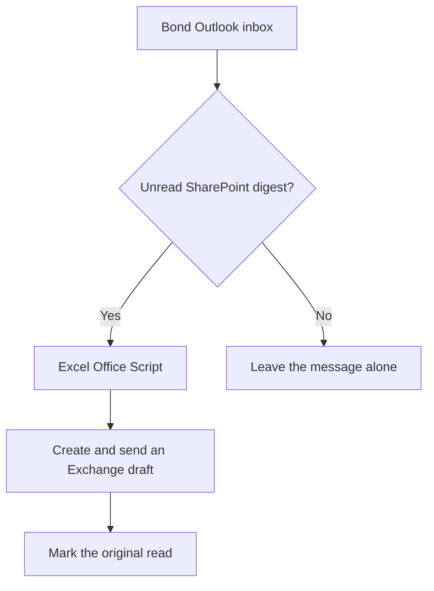
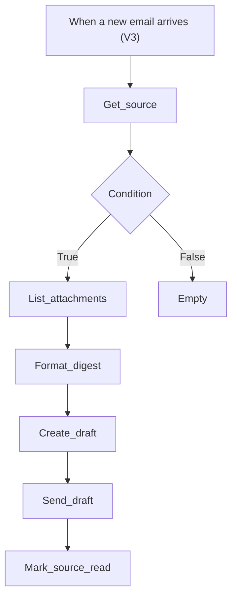

# Staff News in Bond Microsoft 365

Use the [SDC group mailbox setup](group-mailbox.md) to process digests sent to `sdc@groups.bond.edu.au` and return them to the original sender. The steps below cover a personal Bond inbox.

In SharePoint, use **Email a news digest** with any title and send it to your own Bond address. Power Automate looks for a subject such as `Joshua shared "Campus Updates" with you`, formats the digest in an Office Script, and sends the result to the same inbox. Leave the original unread until the flow finishes.



The workflow uses the **Office 365 Outlook** and **Excel Online (Business)** connectors in Bond’s tenant. The workbook is an execution target for the script. The script receives the email body and inline images, renders Staff News in memory, and returns the draft to the flow. It embeds the approved logo and article images from the message. Dated subjects and the Careers at Bond schedule use Brisbane time.

## Check whether Bond enables it

1. Open **Excel for the web** with your Bond account. In a new workbook, look for **Automate → New Script**.
2. In your Bond Power Automate environment, check for **Excel Online (Business) → Run script** and **Office 365 Outlook**. Both are standard connectors. Office Scripts still requires a supported Microsoft 365 licence and the ability to run scripts in that environment. The saved flow must also satisfy Bond’s data policies. [Office Scripts requirements](https://learn.microsoft.com/en-us/office/dev/scripts/testing/platform-limits) · [Excel connector](https://learn.microsoft.com/en-us/connectors/excelonlinebusiness/) · [Outlook connector](https://learn.microsoft.com/en-us/connectors/office365/) · [Power Platform data policies](https://learn.microsoft.com/en-us/power-platform/admin/wp-data-loss-prevention)

## 1. Save the Office Script

1. Save a blank workbook named **Digest Bot.xlsx** in your Bond OneDrive for Business. Keep editing access limited to the people who maintain the flow.
2. Open the workbook in Excel for the web. Select **Automate → New Script**. Open the raw view of [format-staff-news.ts](format-staff-news.ts), copy the complete script, and replace the sample code in the editor.
3. Name the script **Format Bond Staff News** and save it. The script uses its input fields when Power Automate runs it. [Pass data to and from Office Scripts](https://learn.microsoft.com/en-us/office/dev/scripts/develop/power-automate-parameters-returns)

## 2. Build the flow card by card

Build the flow in the designer so it can use your Bond connections, workbook, and script. The repository’s [flow-definition.json](flow-definition.json) is a wiring reference. Power Automate’s **Import Package (Legacy)** screen takes a ZIP exported from Power Automate. **Code view** lets you inspect a card’s JSON. [Importing a flow package](https://learn.microsoft.com/en-us/power-automate/export-import-flow-non-solution) · [Code view](https://learn.microsoft.com/en-us/power-automate/guidance/coding-guidelines/use-peekcode-addnotes)



- **Add a card.** Click the **+** directly below the previous card. The designer connects the new card in that spot.
- **Rename a card.** Select it, then click its name at the top of the configuration pane. Use the exact name shown below, including underscores, so the later expressions can find it.
- **Find a field.** Check **Advanced parameters → Show all** if it is hidden.
- **Enter a value.** For fields marked **fx**, select the field, select **fx**, paste the expression, and select **Add**. Enter other values directly. [Cloud flows designer](https://learn.microsoft.com/en-us/power-automate/flows-designer)

### Card 1 · When a new email arrives (V3)

Open [Power Automate](https://make.powerautomate.com) in your Bond environment. Select **Create → Automated cloud flow** and enter **Staff News to my Bond inbox** as the flow name. Search for **When a new email arrives (V3)**, choose the one under **Office 365 Outlook**, then select **Create**. Use your Bond account for all Outlook and Excel cards.

| Trigger setting | Value |
| --- | --- |
| Folder | **Inbox** |
| From and To | Your own Bond address in both fields |
| Subject Filter | Leave blank |
| Only with Attachments | **No** |
| Include Attachments | **No** |
| Settings → Concurrency control | **On**, degree of parallelism **1** |

If you already built the flow, clear **Subject Filter** in **Parameters** and replace the existing condition in **Settings → Trigger conditions**. For a new flow, select **+ Add** there. Paste this as one condition, including the leading `@`. It accepts any quoted title within the SharePoint subject pattern, including curly quotes, and skips replies and forwards. The later **Condition** and Office Script check the unread state and that the email contains Bond SharePoint news. [Trigger conditions](https://learn.microsoft.com/en-us/power-automate/customize-triggers)

```text
@and(
  not(startsWith(trim(coalesce(triggerBody()?['subject'], '')), 'RE:')),
  not(startsWith(trim(coalesce(triggerBody()?['subject'], '')), 'FW:')),
  not(startsWith(trim(coalesce(triggerBody()?['subject'], '')), 'FWD:')),
  greater(indexOf(replace(trim(coalesce(triggerBody()?['subject'], '')), '“', '"'), ' shared "'), 0),
  endsWith(replace(trim(coalesce(triggerBody()?['subject'], '')), '”', '"'), '" with you')
)
```

### Card 2 · Get_source

Click **+** directly below the trigger. Add **Office 365 Outlook → Get email (V2)** and rename it `Get_source`.

| Field | Value |
| --- | --- |
| Message Id | **fx** `triggerBody()?['id']` |
| Include Attachments | **No** |

### Card 3 · Condition

Click **+** directly below `Get_source` and add **Control → Condition**. Use one condition row.

| Left field | Operator | Right field |
| --- | --- | --- |
| **fx** expression below | **is equal to** | **fx** `true` |

```text
and(
  equals(body('Get_source')?['isRead'], false),
  contains(toLower(coalesce(body('Get_source')?['body'], '')), 'microsoft 365'),
  contains(toLower(coalesce(body('Get_source')?['body'], '')), 'bonduni.sharepoint.com')
)
```

The condition checks the current unread state and SharePoint markers. Leave **False** empty. Add cards 4 through 8 in order **inside True**. In the classic designer, that branch is called **If yes**. [Add a condition](https://learn.microsoft.com/en-us/power-automate/add-condition)

### Card 4 · List_attachments

Click the **+ inside True**. Add **Office 365 Outlook → Send an HTTP request** and rename it `List_attachments`. Select the action from the Outlook connector so it uses your Bond mailbox connection. Set **Method** to `GET` and paste this into **URI** using **fx**.

```text
concat('https://graph.microsoft.com/v1.0/me/messages/', uriComponent(triggerBody()?['id']), '/attachments?$top=100')
```

Leave **Body** empty. The action reads the source message’s attachments through Microsoft Graph. [List message attachments](https://learn.microsoft.com/en-us/graph/api/message-list-attachments)

### Card 5 · Format_digest

Click **+** below `List_attachments` inside **True**. Add **Excel Online (Business) → Run script** and rename it `Format_digest`. Choose these values to load the script’s input fields. [Run a script in Power Automate](https://learn.microsoft.com/en-us/office/dev/scripts/tutorials/excel-power-automate-manual)

| Field | Value |
| --- | --- |
| Location | **OneDrive for Business** |
| Document Library | **OneDrive** |
| File | **Digest Bot.xlsx** |
| Script | **Format Bond Staff News** |

| Script input | Value |
| --- | --- |
| `sourceHtml` | **fx** `coalesce(body('Get_source')?['body'], '')` |
| `sourceAttachments` | **fx** `string(coalesce(body('List_attachments')?['value'], json('[]')))` |
| `mailbox` | Your Bond email address |
| `brisbaneDate` | **fx** `convertTimeZone(utcNow(), 'UTC', 'E. Australia Standard Time', 'yyyy-MM-dd')` |
| `careersWeekday` | `Wednesday` or another weekday |

### Card 6 · Create_draft

Click **+** below `Format_digest` inside **True**. Add another **Office 365 Outlook → Send an HTTP request** and rename it `Create_draft`. If **Content-Type** or **Body** is hidden, open **Advanced parameters** and select it.

| Field | Value |
| --- | --- |
| Method | `POST` |
| URI | `https://graph.microsoft.com/v1.0/me/messages` |
| Content-Type | `application/json` |
| Body | **fx** `body('Format_digest')?['result']` |

Use the script expression as the whole **Body** value. Microsoft Graph creates the draft and returns its ID. [Create a draft](https://learn.microsoft.com/en-us/graph/api/user-post-messages)

### Card 7 · Send_draft

Click **+** below `Create_draft` inside **True**. Add **Office 365 Outlook → Send a Draft message** and rename it `Send_draft`.

| Field | Value |
| --- | --- |
| Message Id | **fx** `body('Create_draft')?['id']` |

### Card 8 · Mark_source_read

Click **+** below `Send_draft` inside **True**. Add **Office 365 Outlook → Mark as read or unread (V3)** and rename it `Mark_source_read`.

| Field | Value |
| --- | --- |
| Message Id | **fx** `triggerBody()?['id']` |
| Mark as | **Read**, or **Yes** if shown as a Yes/No field |

`Send_draft` uses the **new draft ID**. `Mark_source_read` uses the **original Inbox message ID**.

Keep **Run after** set to success. On `Create_draft` and `Send_draft`, select **Settings → Retry policy → None** to avoid repeating a request that Exchange may have accepted before a timeout. Enable **Secure inputs** and **Secure outputs** where available for the steps that handle the digest. Select **Save**. [Secure data in cloud flows](https://learn.microsoft.com/en-us/power-automate/guidance/coding-guidelines/use-secure-inputs-outputs-triggers)

## 3. Test a small digest

1. In SharePoint, choose **Email a news digest** and send one approved test digest to your Bond address with a title such as **Campus Updates**. Leave it unread.
2. In **Run history**, check that the flow accepted the SharePoint subject `Joshua shared "Campus Updates" with you`. Verify the formatted result has pictures and the original was marked read. The formatted reply uses a dated **Bond Staff News** subject and does not start another run.
3. If the flow fails after creating or sending a draft, check your Drafts and Sent Items before resubmitting it.

| Symptom | Check |
| --- | --- |
| New Script or Run script is unavailable | Bond's licence assignment and Office Scripts settings. |
| Run script has no input fields | Confirm you saved **Format Bond Staff News** in Excel. Select that script in the card again. If you changed its inputs after adding the card, re-add **Run script**. [Office Script parameters](https://learn.microsoft.com/en-us/office/dev/scripts/develop/power-automate-parameters-returns) |
| An expression cannot find an action | Check the referenced card name against the guide, including underscores, and re-enter the value through **fx**. |
| No flow run | Check the selected folder, **From**, **To**, and the `shared "…" with you` subject pattern. Clear any value in **Subject Filter** and remove an old trigger condition tied to a specific title. |
| The condition is false | The source is still unread and has the standard Microsoft 365 footer and a link on `bonduni.sharepoint.com`. |
| A thumbnail is missing | It arrived with a matching inline attachment. The script uses embedded images from the source and leaves remote images out of the draft. |
| Draft action failed | The Outlook connection is the Bond mailbox and uses the `/me/messages` URI, `application/json` and the complete script result as the body. |

Turn off this flow in **My flows** to pause its inbox automation.

## If Office Scripts is unavailable

| Situation | Option inside Bond |
| --- | --- |
| Outlook and SharePoint actions are available in Power Automate | Save the matched original EML in a restricted Bond SharePoint library. A Bond-managed worker can read that library, reuse the existing Node formatter, and write the completed draft back for the flow to send. Scope the worker’s access to that site or library. [SharePoint connector](https://learn.microsoft.com/en-us/connectors/sharepointonline/) · [Graph selected permissions](https://learn.microsoft.com/en-us/graph/permissions-selected-overview) |
| Power Automate is unavailable or Bond wants ITS to own the service | Run the existing parser and renderer on infrastructure managed and approved by Bond, such as a private Azure Function. Bond ITS can use a private workflow or scheduled worker with Exchange access scoped to an approved mailbox. [Private Azure Functions](https://learn.microsoft.com/en-us/azure/azure-functions/functions-create-vnet) · [Private Logic Apps networking](https://learn.microsoft.com/en-us/azure/logic-apps/secure-single-tenant-workflow-virtual-network-private-endpoint) |

For code changes, start with [the Office Script](format-staff-news.ts). It extracts SharePoint article fields, accepts a single Bond recipient, and builds an Exchange draft. The script embeds the [logo](../assets/bond-logo.png) and [Careers at Bond image](../assets/careers-at-bond.png). Run `npm test` with Node.js 24 or later from the repository root to check changes against synthetic email and the existing Staff News layout.
