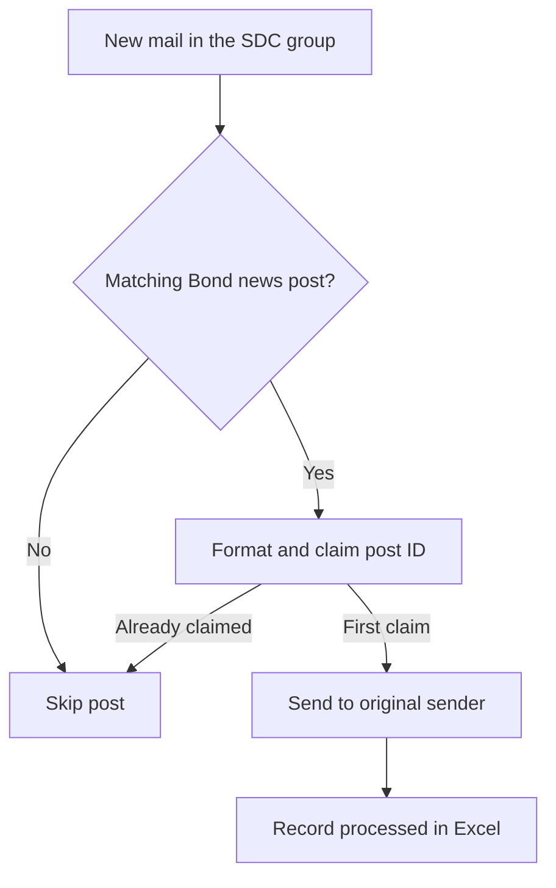

# Send a digest to the SDC Microsoft 365 group

In SharePoint, choose **Email a news digest** with any title and send it to **sdc@groups.bond.edu.au**. The flow watches the group's own mailbox. It reads the sender from the group post and returns the formatted digest to that `@bond.edu.au` address through the flow's Bond Outlook connection. Group members can keep inbox copies turned off.

Microsoft exposes a group email trigger and actions for conversations, threads and posts. The supported group actions have no **Mark as read** operation. This flow records the source post as **Processed** in **Digest Bot.xlsx** after Outlook accepts the send. The group's Outlook read indicator requires a manual action. [Groups Mail connector](https://learn.microsoft.com/en-us/connectors/office365groupsmail/) · [Microsoft Graph group post operations](https://learn.microsoft.com/en-us/graph/api/resources/post)



## 1. Prepare the workbook and connections

1. Open **Digest Bot.xlsx** in Bond OneDrive for Business and use the existing **Format Bond Staff News** Office Script. If you need to create the workbook or script, follow [Save the Office Script](README.md#1-save-the-office-script).
2. In Excel for the web, select **Automate → New Script**. Paste [group-post-state.ts](group-post-state.ts) from its raw view, name the script **Track Digest Bot Group Posts**, and save it. The script creates a worksheet named **Digest Bot Group Posts** on its first claim. The worksheet records post IDs, states and timestamps.
3. Sign in to [Power Automate](https://make.powerautomate.com) in Bond's environment. Use a Bond account with access to the SDC group, the workbook and an Outlook mailbox for sending.

## 2. Read the group conversation

Create an **Automated cloud flow** named **SDC group digest**. Add the cards below in order. Use the exact card names, including underscores. In **fx** fields, paste the expression without a leading `@`. [Power Automate designer](https://learn.microsoft.com/en-us/power-automate/flows-designer)

| Order | Card | Settings |
| --- | --- | --- |
| 1 | **Office 365 Groups Mail → When a new email arrives to a group** | Select the group for **sdc@groups.bond.edu.au** in **Group ID**. If it is absent, confirm your Bond account has access and use the actual Microsoft Entra group **Object ID** under **Enter custom value**. In **Settings**, enable **Concurrency control** with degree **1**. Keep **Split On** enabled with `@triggerOutputs()?['body/value']` as the array. |
| 2 | **Office 365 Groups Mail → Get a group conversation** as `Get_group_conversation` | Select the same **Group ID**. For **Conversation ID**, enter **fx** `triggerBody()?['id']`. |
| 3 | **Data Operations → Compose** as `Digest_topic` | **Inputs** is **fx** `trim(coalesce(body('Get_group_conversation')?['topic'], ''))`. |
| 4 | **Control → Condition** as `If_digest_topic` | Left is the **fx** expression below. Use **is equal to** and **fx** `true` on the right. |

```text
and(
  not(startsWith(outputs('Digest_topic'), 'RE:')),
  not(startsWith(outputs('Digest_topic'), 'FW:')),
  not(startsWith(outputs('Digest_topic'), 'FWD:')),
  greater(indexOf(replace(outputs('Digest_topic'), '“', '"'), ' shared "'), 0),
  endsWith(replace(outputs('Digest_topic'), '”', '"'), '" with you')
)
```

This matches a conversation topic like `Joshua shared "Campus Updates" with you`. The title can be any text. Place the next steps in **True** and leave **False** empty.

## 3. Read the incoming posts and find the sender

| Place the card | Card | Settings |
| --- | --- | --- |
| Inside **True** of `If_digest_topic` | **Control → Apply to each** as `For_each_thread` | **fx** `coalesce(triggerBody()?['threads'], json('[]'))` |
| Inside `For_each_thread` | **Control → Apply to each** as `For_each_post` | **fx** `coalesce(items('For_each_thread')?['posts'], json('[]'))` |
| Inside `For_each_post` | **Office 365 Groups Mail → Get a thread post** as `Get_group_post` | Same **Group ID**. For **Thread ID**, use **fx** `items('For_each_thread')?['id']`. For **Post ID**, use **fx** `items('For_each_post')?['id']`. |
| Below `Get_group_post` | **Data Operations → Compose** as `Source_sender` | **Inputs** is **fx** `toLower(trim(coalesce(body('Get_group_post')?['sender']?['emailAddress']?['address'], '')))`. |
| Below `Source_sender` | **Control → Condition** as `If_Bond_digest` | Left is the **fx** expression below. Use **is equal to** and **fx** `true` on the right. |

```text
and(
  endsWith(outputs('Source_sender'), '@bond.edu.au'),
  contains(toLower(coalesce(body('Get_group_post')?['body']?['content'], '')), 'microsoft 365'),
  contains(toLower(coalesce(body('Get_group_post')?['body']?['content'], '')), 'bonduni.sharepoint.com')
)
```

The two loops handle the threads and posts in one group notification. Keep them sequential. **Get a thread post** returns the body, sender and attachments. The Office Script uses thumbnail attachments that have a matching content ID. An empty sender or a sender outside `@bond.edu.au` is skipped. [Microsoft's group mail flow example](https://www.microsoft.com/en-us/power-platform/blog/power-automate/use-our-new-office-365-groups-mail-connector/) · [Group post sender field](https://learn.microsoft.com/en-us/graph/api/resources/post)

## 4. Format and reserve the post

Inside **True** of `If_Bond_digest`, add these three cards.

### Format_digest

Add **Excel Online (Business) → Run script**. Select **OneDrive for Business → OneDrive → Digest Bot.xlsx** and choose **Format Bond Staff News**.

| Script input | Value |
| --- | --- |
| `sourceHtml` | **fx** `coalesce(body('Get_group_post')?['body']?['content'], '')` |
| `sourceAttachments` | **fx** `string(coalesce(body('Get_group_post')?['attachments'], json('[]')))` |
| `mailbox` | **fx** `outputs('Source_sender')` |
| `brisbaneDate` | **fx** `convertTimeZone(utcNow(), 'UTC', 'E. Australia Standard Time', 'yyyy-MM-dd')` |
| `careersWeekday` | `Wednesday` or your preferred weekday |

### Claim_post

Add a second **Run script** card below `Format_digest`. Select the same workbook and choose **Track Digest Bot Group Posts**. In **Settings**, set **Retry policy** to **None**.

| Script input | Value |
| --- | --- |
| `postId` | **fx** `items('For_each_post')?['id']` |
| `recordProcessed` | **fx** `false`. If the card displays a Boolean selector, choose **No**. |

### If_claimed

Add **Control → Condition** below `Claim_post`. Set the left field to **fx** `body('Claim_post')?['result']`, the operator to **is equal to**, and the right field to **fx** `true`. Leave **False** empty. A post can be claimed once.

## 5. Send the draft and record completion

The Outlook connection owns the draft and sends the reply. `Format_digest` sets the **To** address from `Source_sender`, so the original sender receives the formatted copy. `Send_draft` sends the draft with its inline images. [Create a message draft](https://learn.microsoft.com/en-us/graph/api/user-post-messages) · [Send a draft](https://learn.microsoft.com/en-us/connectors/office365connector/#send-a-draft-message)

Add these cards inside **True** of `If_claimed`.

| Order | Card | Settings |
| --- | --- | --- |
| 1 | **Office 365 Outlook → Send an HTTP request** as `Create_draft` | **Method** `POST`. **URI** `https://graph.microsoft.com/v1.0/me/messages`. **Content-Type** `application/json`. **Body** is **fx** `body('Format_digest')?['result']`. |
| 2 | **Office 365 Outlook → Send a Draft message** as `Send_draft` | **Message Id** is **fx** `body('Create_draft')?['id']`. Use the same Bond Outlook connection as `Create_draft`. |
| 3 | **Excel Online (Business) → Run script** as `Record_processed` | Same workbook, script **Track Digest Bot Group Posts**. **postId** is **fx** `items('For_each_post')?['id']`. **recordProcessed** is **fx** `true` or **Yes**. |

Keep these actions in sequence with **Run after** set to success. Set **Retry policy** to **None** on `Create_draft` and `Send_draft` to avoid repeating a send with an uncertain result. Enable **Secure inputs** and **Secure outputs** where available on cards that handle digest contents. Save the flow. [Outlook connector](https://learn.microsoft.com/en-us/connectors/office365/) · [Secure data in cloud flows](https://learn.microsoft.com/en-us/power-automate/guidance/coding-guidelines/use-secure-inputs-outputs-triggers)

## 6. Test the switch to the group

1. Ask another Bond user to send an approved SharePoint test digest to **sdc@groups.bond.edu.au** with a title such as **Campus Updates**.
2. In **Run history**, check that `Create_draft` and `Send_draft` succeed. Confirm that the reply in the connected mailbox's **Sent Items** is addressed to that user, that their copy shows the inline images, and that the post is **Processed** in **Digest Bot.xlsx**.
3. Turn off the old personal Inbox flow so the group is the sole intake. A digest sent only to a personal inbox should produce no group run.

### If the formatted email stays in Drafts

1. In **Run history**, open the run that created the draft. Expand the **True** branch under `If_claimed`. `Send_draft` must be the **Office 365 Outlook → Send a Draft message** action immediately after `Create_draft`.
2. Set **Message Id** to **fx** `body('Create_draft')?['id']`, then confirm both cards use the same Outlook connection and **Run after** is set to **is successful** on `Create_draft`.
3. If the draft's **To** address is wrong, check that `Source_sender` reads the sender of `Get_group_post` and that the `mailbox` field in `Format_digest` uses **fx** `outputs('Source_sender')`.

A claimed post stays **Pending** until the flow records a successful send. Check **Sent Items** and **Drafts** to see what happened. After fixing the flow, send a fresh SharePoint test digest. The existing post ID has already been claimed.

If the Outlook read flag is essential, Bond ITS can provision an **Exchange shared mailbox** as the intake. That mailbox type supports the **When a new email arrives in a shared mailbox (V2)** trigger and **Mark as read or unread (V3)** with the shared mailbox address. [Shared mailbox administration](https://learn.microsoft.com/en-us/microsoft-365/admin/email/create-a-shared-mailbox) · [Outlook connector](https://learn.microsoft.com/en-us/connectors/office365/)

The [group flow definition](group-flow-definition.json) records the card wiring for review. The designer binds the real group, workbook, scripts and Outlook connection.
